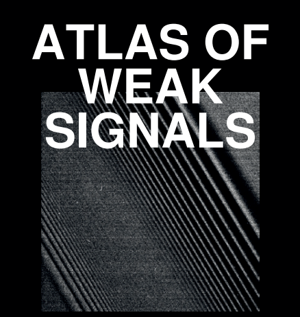
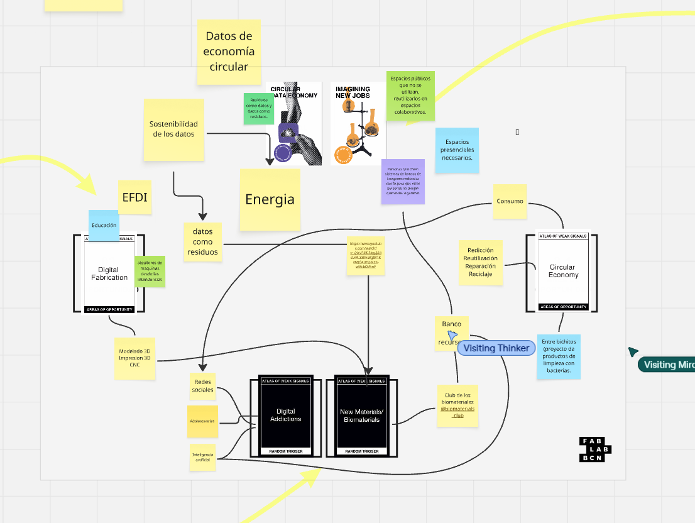

---
hide:
    - toc
---

# **Módulo de Diseño - Bloque 1**

Bienvenidos y bienvenidas al Eje de Diseño. En este bloque compartiré sobre el módulo de diseño: proyecto y contexto. Primero comenzaré mostrando las herramientas que se presentán en una primera instancia. 

## **Miro**

{ width=250 align=right}

Herramienta digital en línea donde se comparte un espacio de trabajo para colaborar con otras personas en tiempo real. Es una especie de "pizarra virtual" 

## **Atlas of weak signals**

{ width=250 align=right}

Herramienta diseñada por Mariana Quintero con el objetivo de identificar "...señales débiles en un espacio práctico para comprender y analizar posibles escenarios emergentes basados ​​en las tendencias subyacentes de nuestro mundo actual." (Fab Lab Barcelona, 2022, *Atlas of weak signals*) 

La modalidad se trata de seleccionar diferentes cartas dentro de diferentes categorías de manera aleatoria o "al azar", armando nuestro tablero para comenzar a crear conexiones entre ellas. 

## **Primer clase MD01**

Entonces, utilizaremos *Miro* como espacio de trabajo para utilizar el *Atlas*. En esta primer clase nos dividimos en equipos para probar, jugar y compartir un primer acercamiento.

## **Canva personal**

Una vez seleccionadas las cartas a utilizar comenzaremos a exponer que nos despierta cada carta, que entendemos por cada una de ellas. Luego podremos empezar a identificar conexiones entre las mismas. Tendremos varias categorías de referencias a incluir dentro de los vínculos.

[*Ver lamina*](https://miro.com/app/live-embed/uXjVHoVOrq4=/?embedMode=view_only_without_ui&moveToViewport=18847%2C10687%2C1015%2C815&embedId=956033054188){target="_blank"}

[*Ver lamina*](https://miro.com/app/live-embed/uXjVHoVOrq4=/?embedMode=view_only_without_ui&moveToViewport=21274%2C10790%2C1390%2C906&embedId=329330177230){target="_blank"}

A partir de las palabras, proyectos, referencias artísticas que surgen de las diferentes cartas que seleccione al azar, surgen varias temáticas que podrían ser disparadores para situaciones problema o de interés. Como podemos ver en la primera lámina decidí colocar en el medio aquellas temáticas que nacen de las interconexión, las siguientes son:

1. Regulación del agua en el uso de tecnologías

2. Creación de un repositorio de mujeres y disidencias destacadas de Uruguay

3. Diseño de tecnologías o productos para mitigar el impacto del CO2

4. Accesibilidad en asentamientos

Luego, comencé a colocar en el espacio multiescalar las diferentes temáticas de interés agregando búsquedas (post it negros) más específicas de proyectos, productos e instituciones relacionadas a los tópicos.

Como último paso y selección de una de las temáticas, decido seleccionar una de ellas para definir un posible proyecto con una posible propuesta de acción:

**Quiero explorar la accesibilidad en barrios marginados a través del Diseño colaborativo para crear comunidades inclusivas que transformen la calidad de vida de sus habitantes.**

# Conclusiones:

Resultó interesante la herramienta del Atlas y cómo a partir de conectarlas surgen muchas temáticas de interés. En mi caso al haber seleccionado al azar fue difícil entender cómo esas cartas podían llegar a relacionarse. Sin embargo, luego de exponer lo que cada una de ellas individualmente “despertaba”, se iban generando estas conexiones.
Pienso que podría ser interesante hacer el mismo proceso pero eligiendo las cartas pensando en mi profesión, en las habilidades y conocimientos que puedo tener, creo que sería útil y me podría ayudar a definir un proyecto para este curso.

## **Links**

[*Logo Miro*](https://logolook.net/miro-logo/){target="_blank"}

[*Atlas of weak signals*](../files/MOD1/WeakSignals-.pdf){target="_blank"}

[*Manual Atlas of weak signals*](../files/MOD1/WeakSignals-manual.pdf){target="_blank"}

[*Fab Lab Barcelona*](https://fablabbcn.org/blog/emergent-ideas/atlas-of-weak-signals){target="_blank"}