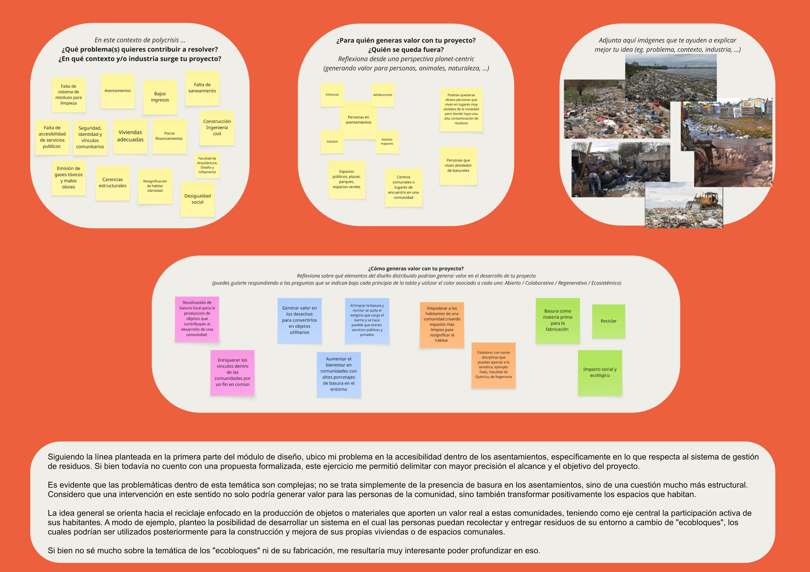

---
hide:
    - toc
---

# **Módulo de Innovación - Bloque 1**

Bienvenidos y bienvenidas al Eje temático de Innovación y Sostenibilidad. 

Objetivos específicos:

- Desarrollar competencias para identificar oportunidades y abordar desafíos mediante metodologías y herramientas de innovación, diseño y experimentación.

- Promover el desarrollo de soluciones innovadoras y sostenibles que generen impacto en contextos productivos, sociales y territoriales.

- Fortalecer el rol de los y las participantes como agentes de cambio, capaces de impulsar procesos de innovación y transformación en sus organizaciones y comunidades.

El ejercicio es completar el diagrama, analizando sus preguntas y respondiendo según la temática en la cual vengo trabajando desde el MD01. 

[*Ver lamina*](../innovacion/Documentos/Lamina_MI01_Federica%20Rivedieu.pdf){target="_blank"}

# Conlusiones

Esta nueva herramienta fue útil para definir mas la temática, identificar problemas, que valor puede tener una solución y como generalo. Sin embargo, ahora teniendo que definir mi proyecto analizo que no es una poblemática que quiera trabajar en este momento. 

Cuando comenzé el posgrado tenia como objetivo poder experimentar la fabricación digital para la optimización de procesos de fabricación de mobiliarios. Como diseñadora contaba con un proyecto de producción de mobiliario, junto con un colega creamos diferentes soluciones para diversos clientes. La problemática de esto es que resultó ser un proceso muy largo y costoso. 

Para mi proyecto integrador me gustaría desarrollar mediante diferentes herramientas de fabricación digital un mobiliario de diseño, que sea economicamente accesible, de fácil armado y utilizando materias primas locales. 

En el siguiente modulo de diseño (MD02) comenzaré a definir este proyecto de interés.