---
hide:
    - toc
---
# MT02 - Diseño 2D y Modelado 3D

El objetivo del módulo es adquirir las habilidades necesaria para el diseño 2D y 3D en el contexto de la Fabricación Digital a partir del desarrollo de un producto.

*"Diseñar un objeto utilitario compuesto por al menos dos piezas relacionadas y contar con un logo/ícono en relieve. Generar una lámina de presentación que contenga un título, la imagen del modelo con anotaciones y una breve descripción."* (premisa ejercicio)

En mi caso desde hace varios años que trabajo con el modelado 3D, en especifico con Inventor de Autodesk, programa de modelado paramétrico que a partir de bocetos 2D se aplican extrusión, revolución, vaciado, etc, para crear tu objeto tridimensional.

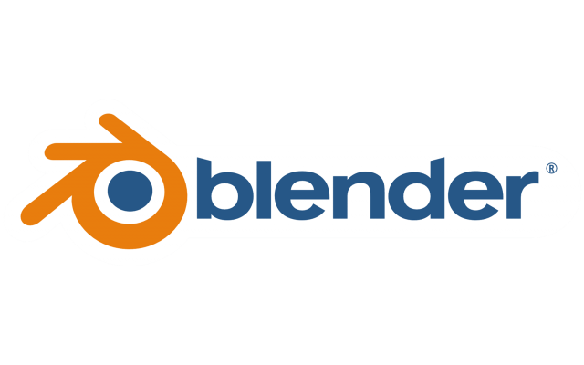{ width=250 align=right}

Es por eso que para realizar la entrega de este bloque aprenderé a usar un programa nuevo de modelado, que funciona con una lógica completamente diferente. Este programa es *Blender*.

{ width=150 align=right}

A su vez, es necesario utilizar algun programa 2D vectorial o pixelar para el diseño gráfico de nuestra entrega. Voy a elegir *Affinity*, programa con herramientas para la creación vectorial, nunca lo utilicé y me interesa incorporarlo.

## Moldelado 3D del objeto con sus piezas relacionadas

Para aprender e implemetar Blender decidí utilizar un objeto de mi casa, una lámpara de mesa. Esto me permite dimensionar sus piezas y poder reproducirlas lo mas proporcional posible. Mi objetivo no fue modelar paramétricamente porque no es una técnica que necesite incorporar. Al mirar varios tutoriales logré identificar herramientas que aplique en mi modelado.

**¿Cómo funciona Blender?**

El flujo de trabajo se basa en la alternancia de dos estados para estructurar y editar cualquier objeto 3D.

*1. Modo objeto:* entorno general donde podemos posicionar, mover, rotar y escalar el objeto. Es el espacio de ensamblaje general.

*2. Modo Edición:* cada objeto tiene su acceso a sus estructuras internas. Aquí es donde podemos manipular los vértices, aristas, caras y puntos de un objeto.

Por otro lado, tenemos las *modificaciones* que son operaciones que se aplican, por ejemplo simetrías, uniones de booleanas, para alterar los objetos.

[**Ver lámina**](../tecnicos/documentos/Lamina%20proceso%20lampara.pdf){target="_blank"}

## Dibujo vectorial de un logo o ícono aplicable al objeto diseñado

Para intoruducirme en Affinity utilicé un tutorial, no hubo una decisión en la estética o en la representatividad del logo, simplemente tomé la imágen que muestran. 

**¿Cómo funciona Affinity?**

Programa vectorial para diseño gráfico y edición digital. Usando vectores, puntos de control y formas primitivas fui dando forma a mi logo.

[**Ver lámina**](../tecnicos/documentos/Lamina%20proceso%20logo.pdf){target="_blank"}

## Aplicar el logo/ícono al objeto en relieve

Al igual que en los pasos anteriores, utilicé videos guías que me ayudaron a lograr el objetivo. En este paso pude fusionar ambos programas, exportando desde Affinity mi logo e importando en Blender, pasando de 2D a 3D y aplicarlo a mi objeto (lámpara).

[**Ver lámina**](../tecnicos/documentos/Proceso%20logo%203d.pdf){target="_blank"}

## Diagramación de lámina de presentación

Síntesis del trabajo realizado, utilizando comentarios e imagénes para presentar el "producto" creado.

[**Ver lámina**](../tecnicos/documentos/LAMINA%20DE%20PRESENTACION_MT02_Federica.Rivedieu.pdf){target="_blank"}

# MT03 - Corte láser controlado por computadora

El objetivo del módulo es adquirir las habilidades necesaria para crear un objeto, utilizando la herramienta corte láser.

*"Diseñar la carcasa de una luminaria (sin sus componentes eléctricos) pensada para ser fabricada utilizando únicamente piezas laminares y encastradas cortadas en láser, sin otros materiales ni elementos de unión."* (Premisa ejercicio)

Para este módulo comencé diseñando una primera luminaria. Al comienzo quise realizar un diseño que fuse orgánico, poder jugar con las herramientas del programa 3D para crear piezas curvas, generando una especie de movimiento.

Herramientas utilizadas:

- Circular pattern

- Trim

- Extrude

- Work plane

- Fillet

- Revolve

[**Ver lámina**](../tecnicos/documentos/Lampara%20prueba%201.pdf){target="_blank"}

Luego de ver el resultado y teniendo en cuenta los objetivos del módulo, decidí cambiar mi diseño. Me interesó probar las técnicas de grabado y kerfing, para el curvado de piezas. La primera idea no era compatible con lo que yo buscaba experimentar, es por eso que volví a pensar una luminaria que me permitiera esto mismo. 

[**Ver lámina**](../tecnicos/documentos/Lampara%20final%20proceso.pdf){target="_blank"}

El objeto consiste en una caja de 3 piezas. Una base maciza, una tapa con un hueco (donde se pondra la bombita de luz) y un contorno hecho con una sola pieza curvada.

Utilicé el kerfing para curvar las esquinas de mi caja. Para esto utilicé un patrón ya existente que lo descargue de "Obrary", una plataforma *open source* (ver en links). En esta web podemos encontrar diverosas tramas. 
Para mi luminaria usé un patrón lineal simple, debía dimensionar el tiempo de la prática presencial y no extenderme con uno muy complejo. Usé este mismo en la parte superior para el grabado y asi generar una continuidad. 

Herramientas utlizadas:

- Extrude

- Countour Flange

- Boolean

- Sheet Metal Style

- Flat Pattern

- Rectangular Pattern

Una vez terminado mi modelado 3D en *Inventor*, exporte los bocetos de las piezas y las importe en *Affinity*, con el objetivo de pulir las líneas y separarlas según el tipo de corte que se espera, asigando un color a cada acción. 

Las divisiones son:

- Corte del contorno de las piezas y hueco en la tapa (color rojo)

- Corte del patrón para Kerfing (color azul)

- Grabado del patrón en la tapa de luminaria (color azul)

- Raster de figura estrellada (color verde)

El último paso para poder fabricar mi luminaria es generar el archivo en el programa *RD Works*, software para diseñar y configurar archivos de corte y grabados láser. Entonces, luego de pulir los bocetos y separar mis líneas en capas, exporté el archivo desde Affinity en formato DXF para importarlo en este último programa. 

Una vez importado el archivo continué por configurar los tipos de cortes. Sin embargo es en la práctica presencial (FP01) donde termino de definir los parámetros, más información en el registro de FP01.

# FP01 - Fabricación presencial en laboratorio

Nuestra primer práctica presencial fue en el laboratorio de UTEC en la ciudad de Minas, departamento de Lavalleja. Fuimos recibidos por Florencia Pilatti, referente del laboratorio. Comenzamos con una introducción sobre el laboratorio, sus principales usos y trabajos que se realizan en el. 

Luego nos presentaron la máquina de corte láser, sus componentes, funcionamiento general y las precausiones a tener en cuenta. A continuación podrán ver algunas imágenes de lo que fue esta práctica.

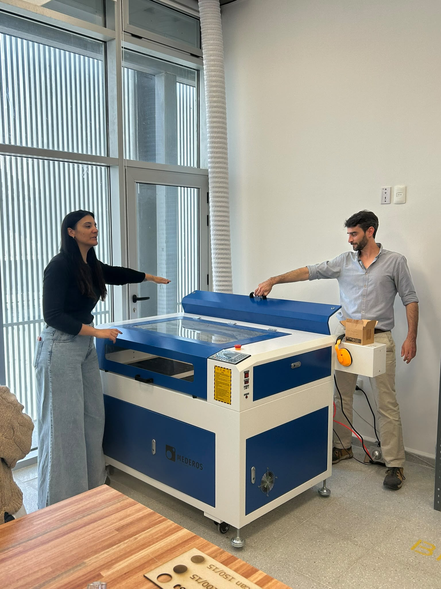{ width=350 }

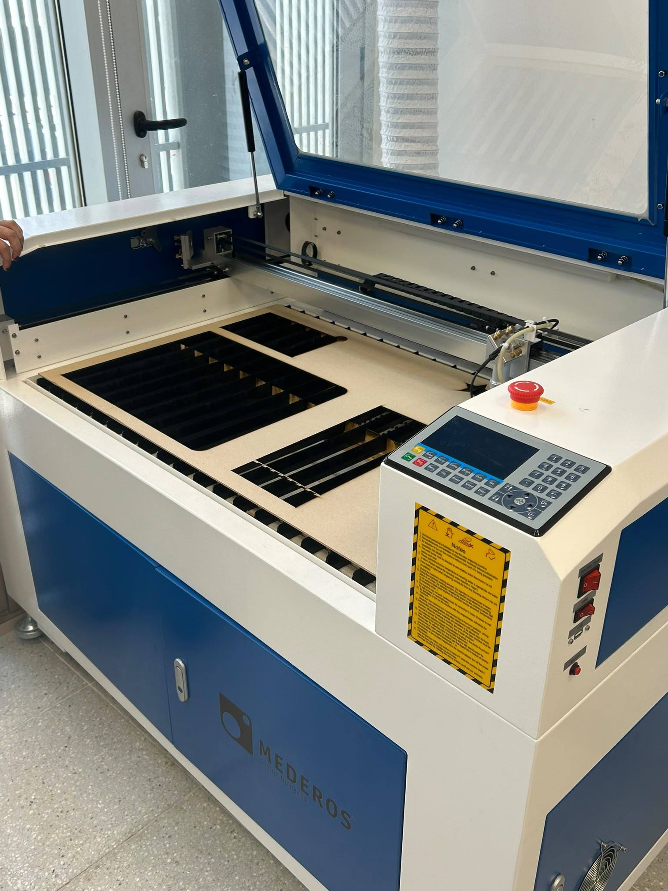{ width=350 }

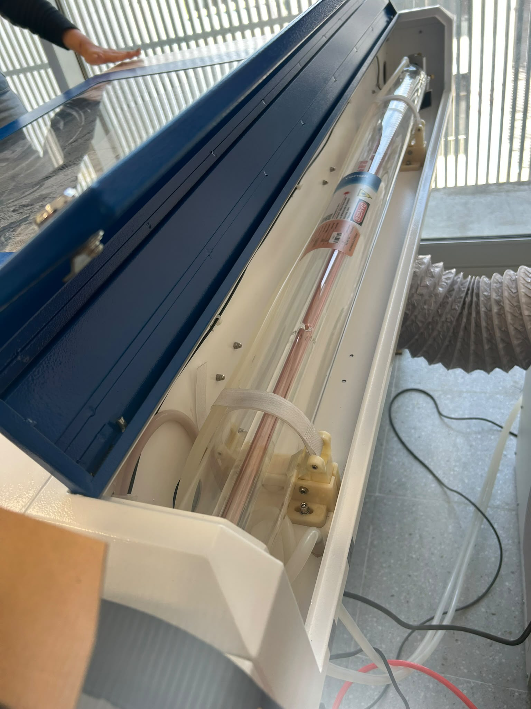{ width=350 }

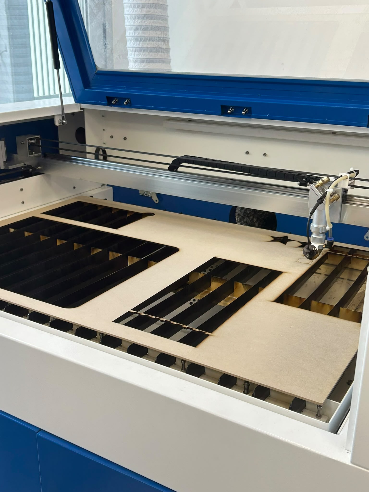{ width=350 }

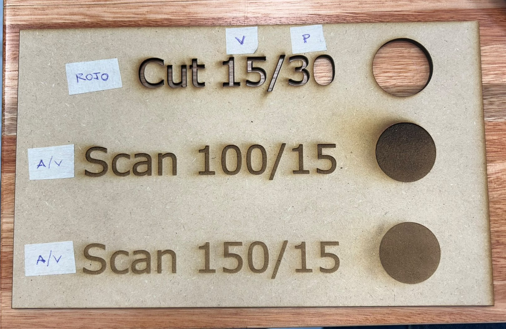{ width=350 }

Este panel fue de mucha ayuda a la hora de configurar el archivo en *RD Works*, según el objetivo que tenia cada línea utilicé estos parámetros (se pueden ver en una de las imágenes en la sección anterior). Tuve la suerte de poder configurar mi archivo en conjunto de los docentes y mis comapañexs. Modifique algunas líneas que parecían superpuestas o no terminaban de cerrar, ádemas de verificar el recorrido del láser para que el corte demorara lo menos posible. El tiempo total resulto ser de 8 minutos. En la imágen siguiente podemos ver el panel de la maquina preparado para empezar a cortar, con sus velocidades y potencias definidas. 

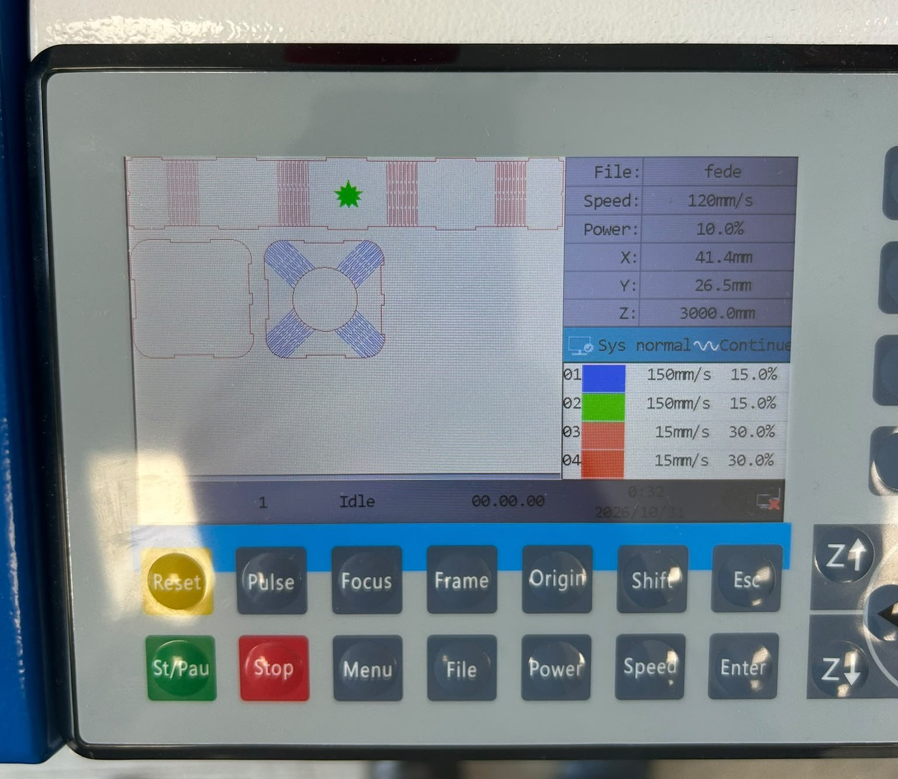{ width=350 }

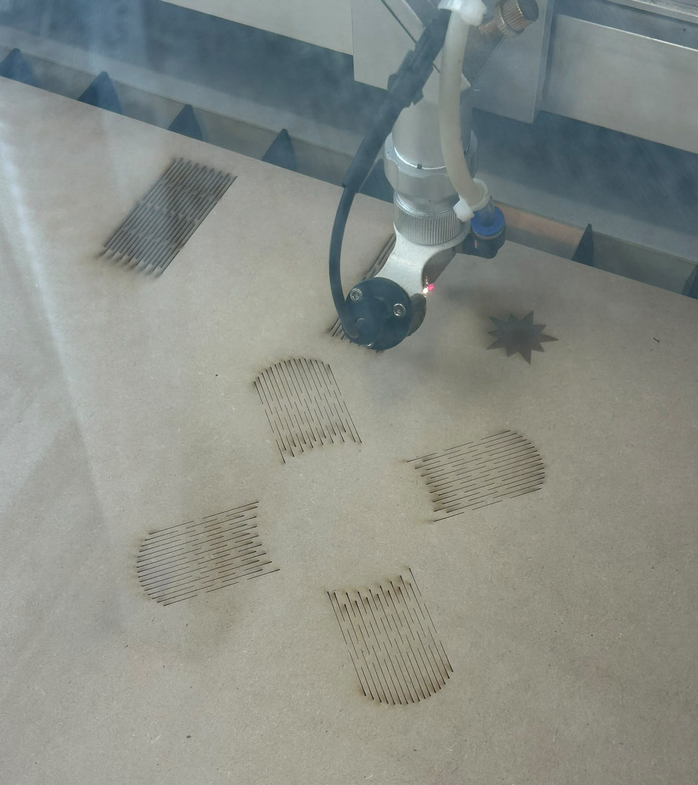{ width=350 }

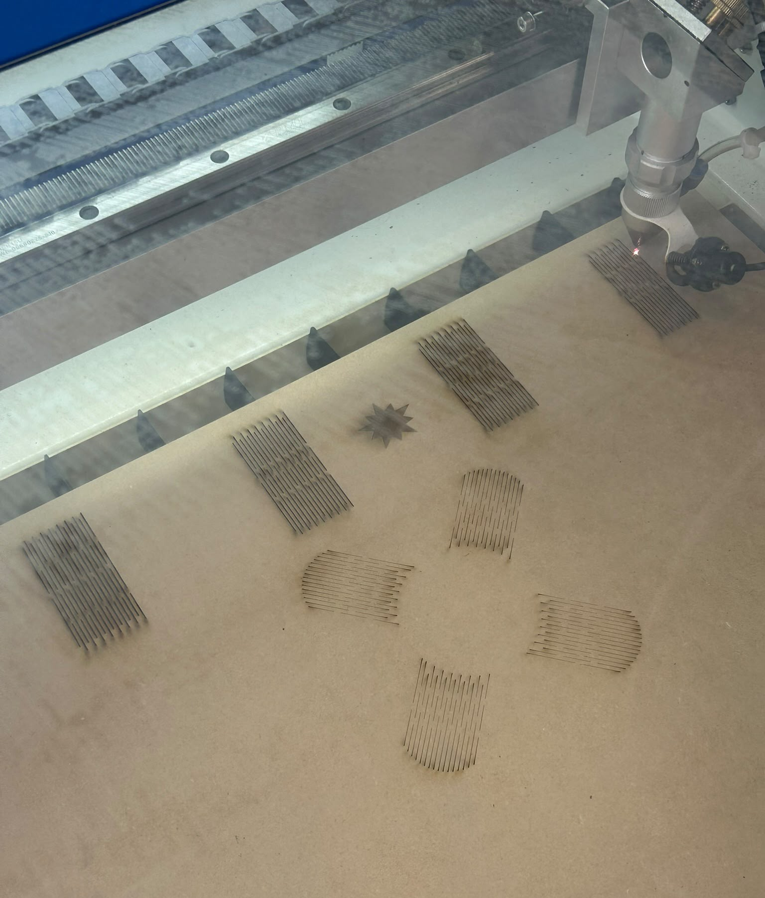{ width=350 }

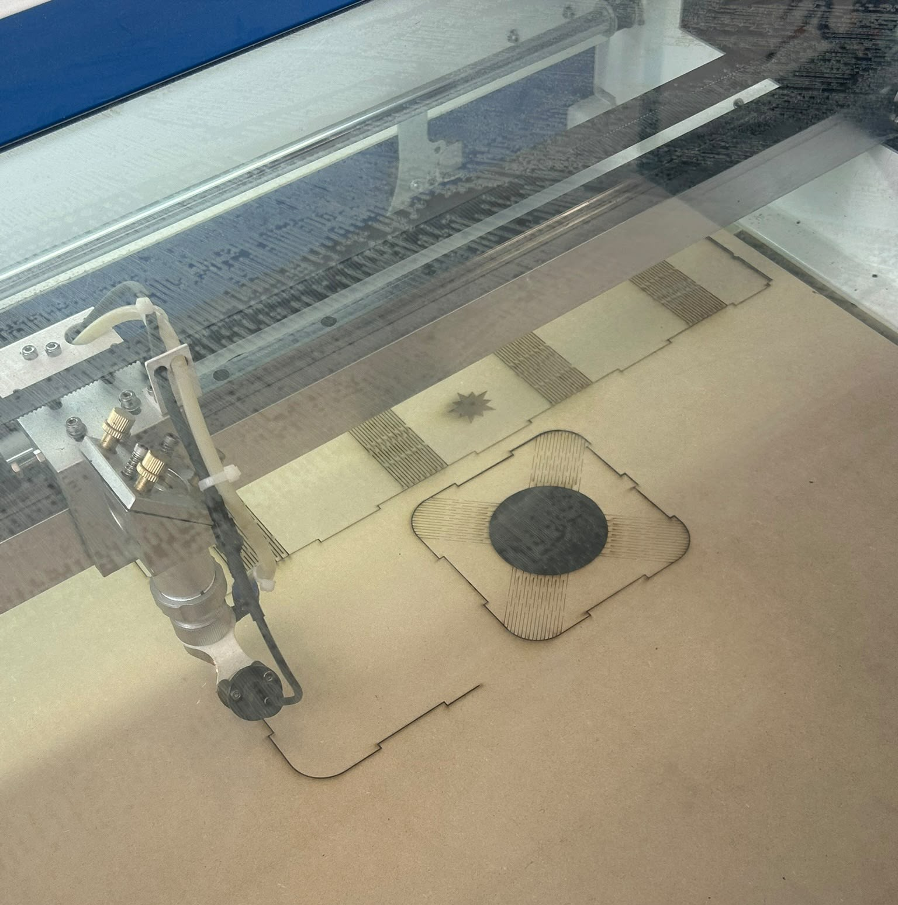{ width=350 }

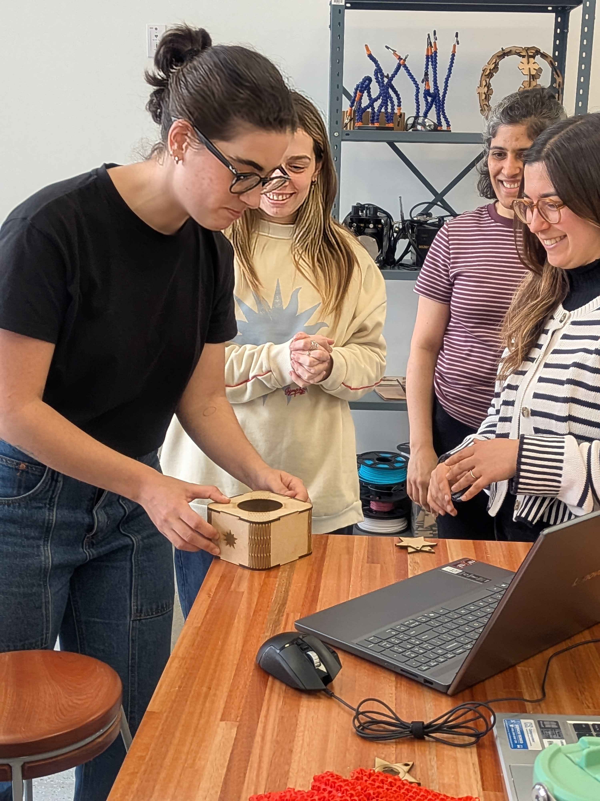{ width=350 }

Tuve un reslutado muy positivo. El primer intento fue suficiente, las piezas quedaron como esperaba. Sin embargo, los encastres no quedaron resistentes, utilicé un adhesivo para unir las partes. Además, para ver el resultado final instalé la parte eléctrica necesaria con una bombita de luz. Aquí algunas imágenes del resultado final:

{ width=350 }

{ width=350 }

{ width=350 }

{ width=350 }

{ width=350 }

## Conlusiones

En este Bloque 1 adquirí muchos conocimientos, dedique varias horas a aprender nuevos programas que sin duda suman mucho valor a mi experiencia como diseñadora.

En el MT02 aprendí dos nuevos programas que me resultaron muy interesantes. Quizas Blender no sea un programa que vaya en la linea del tipo de modelado al cual me gusta apuntar, porque no es paramétrico, pero sin duda es una herramienta que tiene mucho potencial. 
Por otro lado, Affinity me resultó muy útil, amigable y sin duda me servirá a la hora de poder diagramar ideas o proyectos en el futuro. 
La combinación de los programas para lograr el logo en 3D fue lo que me resultó más complicado.

El MT03 me resultó motivador ya que ibamos a poder llevar a la realidad un objeto, así como usar una máquina de corte láser yo misma. No fue un desafío el modelado porque para este módulo usé *Inventor*, programa que ya llevo muchos años utilizando. El desafío estuvo en comprender RD Works, los parámetros para cortar en lasér y la generación del archivo para introducir en la cortadora. 

La experiencia en la práctica presencial fue muy enrriquecedora, conocer a los docentes y compañerxs en la presencialidad fue muy positivo. Visitar y conocer la dinámica en el laboratorio resultó muy motivador y superó mis expectativas. 
En cuanto al objetivo de la visita, poder utilizar yo misma la máquina, comprenderla y poder observar su funcionamiento fue muy constructivo. Además, estoy muy satisfecha con el resultado final.

## **Links**

[*Logo Blender*](https://1000logos.net/blender-logo/){target="_blank"}

[*Logo Affinity*](https://crystalpng.com/product/affinity-logo/){target="_blank"}

[*BLENDER Desde Cero - Tutorial para principiantes 2026*](https://www.youtube.com/watch?v=OtpDxkiNcjY&list=PLX_c-Z2I9L8w&index=2&t=498s&pp=iAQBsAgC){target="_blank"}

[*Blender 3D Modeling software: Glass Perfume Bottle*](https://www.youtube.com/watch?v=D2AgCcC1hjs&list=PLX_c-Z2I9L8w&index=3&pp=iAQBsAgC){target="_blank"}

[*Crea CABLE, TUBOS y CURVAS en Blender*](https://www.youtube.com/watch?v=VGwyXsv6qIM&list=PLX_c-Z2I9L8w&index=1&t=3s&pp=iAQBsAgC){target="_blank"}

[*COMO PINTAR OBJETOS en BLENDER*](https://www.youtube.com/watch?v=nH2J3B-9NAk&list=PLX_c-Z2I9L8w&index=5&pp=iAQBsAgC){target="_blank"}

[*Cómo Crear un LOGOTIPO en Affinity by Canva*](https://www.youtube.com/watch?v=dGso8kkoZ1c&list=PLX_c-Z2I9L8w&index=6&pp=iAQBsAgC){target="_blank"}

[*Blender 5 Tutorial: 2D to 3D Logo Modeling*](https://www.youtube.com/watch?v=mIoLEOucNBE&list=PLX_c-Z2I9L8w&index=7&t=218s&pp=iAQB0gcJCSwMAYcqIYzvsAgC){target="_blank"}

[*How to add text or logo to any surface in Blender 3D*](https://www.youtube.com/watch?v=TNTYWL5UFao&list=PLX_c-Z2I9L8w&index=8&t=305s&pp=iAQBsAgC){target="_blank"}

[*Obrary*](https://obrary.com/){target="_blank"}