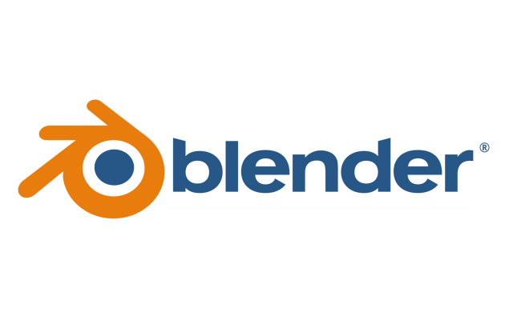

---
hide:
    - toc
---
# MT02 - Diseño 2D y Modelado 3D

El objetivo del módulo es adquirir las habilidades necesaria para el diseño 2D y 3D en el contexto de la Fabricación Digital a partir del desarrollo de un producto.

*"Diseñar un objeto utilitario compuesto por al menos dos piezas relacionadas y contar con un logo/ícono en relieve. Generar una lámina de presentación que contenga un título, la imagen del modelo con anotaciones y una breve descripción."* (premisa ejercicio)

En mi caso desde hace varios años que trabajo con el modelado 3D, en especifico con Inventor de Autodesk, programa de modelado paramétrico que a partir de bocetos 2D se aplican extrusión, revolución, vaciado, etc, para crear tu objeto tridimensional.

{ width=250 align=right}

Es por eso que para realizar la entrega de este bloque aprenderé a usar un programa nuevo de modelado, que funciona con una lógica completamente diferente. Este programa es *Blender*.

{ width=150 align=right}

A su vez, es necesario utilizar algun programa 2D vectorial o pixelar para el diseño gráfico de nuestra entrega. Voy a elegir *Affinity*, programa con herramientas para la creación vectorial, nunca lo utilicé y me interesa incorporarlo.

## Moldelado 3D del objeto con sus piezas relacionadas

Para aprender e implemetar Blender decidí utilizar un objeto de mi casa, una lampara de mesa. Esto me permite poder dimensionar sus piezas y poder reproducirlas lo mas proporcional posible. Mi objetivo no fue modelar paramétricamente porque no es una técnica que necesite incorporar.
Al mirar varios tutoriales logre identificar herramientas que aplique en mi modelado.

## Dibujo vectorial de un logo o ícono aplicable al obejeto diseñado

Para intoruducirme en Affinity, para crear un logo, utilicé un tutorial que segui paso a paso. Por lo tanto no hubo una decision en la estética o en la representatividad del logo, simplemente tomé la imágen que utilizan. 

## Aplicar el logo/ícono al objeto en relieve

Al igual que en los pasos anteriores, utilicé videos guías que me ayudaron a lograr el objetivo. En este paso pude fusionar ambos programas, exportando desde Affinity mi logo e importando en Blender, pasando de 2D a 3D y aplicarlo a mi objeto (lampara).

## Diagramación de lámina de presentación

Síntesis del trabajo realizado, utilizando comentarios e imagénes para presentar el "producto" creado.

# MT03 - Corte láser controlado por computadora

El objetivo del módulo es adquirir las habilidades necesaria para crear un objeto utilizando la herramienta corte láser

*"Diseñar la carcasa de una luminaria (sin sus componentes eléctricos) pensada para ser fabricada utilizando únicamente piezas laminares y encastradas cortadas en láser, sin otros materiales ni elementos de unión."* (Premisa ejercicio)

## **Links**

[*Logo Blender*](https://1000logos.net/blender-logo/){target="_blank"}

[*Logo Affinity*](https://crystalpng.com/product/affinity-logo/){target="_blank"}

[*BLENDER Desde Cero - Tutorial para principiantes 2026*](https://www.youtube.com/watch?v=OtpDxkiNcjY&list=PLX_c-Z2I9L8w&index=2&t=498s&pp=iAQBsAgC){target="_blank"}

[*Blender 3D Modeling software: Glass Perfume Bottle*](https://www.youtube.com/watch?v=D2AgCcC1hjs&list=PLX_c-Z2I9L8w&index=3&pp=iAQBsAgC){target="_blank"}

[*Crea CABLE, TUBOS y CURVAS en Blender*](https://www.youtube.com/watch?v=VGwyXsv6qIM&list=PLX_c-Z2I9L8w&index=1&t=3s&pp=iAQBsAgC){target="_blank"}

[*COMO PINTAR OBJETOS en BLENDER*](https://www.youtube.com/watch?v=nH2J3B-9NAk&list=PLX_c-Z2I9L8w&index=5&pp=iAQBsAgC){target="_blank"}

[*Cómo Crear un LOGOTIPO en Affinity by Canva*](https://www.youtube.com/watch?v=dGso8kkoZ1c&list=PLX_c-Z2I9L8w&index=6&pp=iAQBsAgC){target="_blank"}

[*Blender 5 Tutorial: 2D to 3D Logo Modeling*](https://www.youtube.com/watch?v=mIoLEOucNBE&list=PLX_c-Z2I9L8w&index=7&t=218s&pp=iAQB0gcJCSwMAYcqIYzvsAgC){target="_blank"}

[*How to add text or logo to any surface in Blender 3D*](https://www.youtube.com/watch?v=TNTYWL5UFao&list=PLX_c-Z2I9L8w&index=8&t=305s&pp=iAQBsAgC){target="_blank"}
